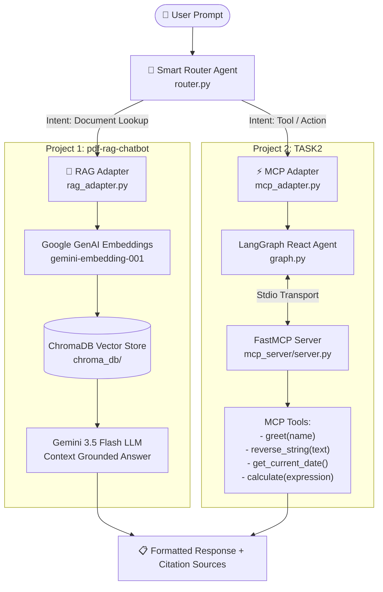

# 🧠 AI Smart Router Agent (PDF RAG + MCP Tool Execution Ecosystem)

[](https://www.python.org/)
[](https://www.langchain.com/)
[](https://langchain-ai.github.io/langgraph/)
[](https://github.com/jlowin/fastmcp)
[](https://deepmind.google/technologies/gemini/)
[](https://www.trychroma.com/)
[](LICENSE)

An enterprise-grade, multi-agent AI system that unifies **Document Retrieval-Augmented Generation (RAG)** and **Model Context Protocol (MCP) Tool Execution** under an intelligent **Smart Router Orchestrator**. 

The system automatically classifies incoming natural language queries and dynamically routes them to either local PDF vector stores for knowledge retrieval or to a FastMCP stdio server for live tool execution.

---

## 📐 Architecture Overview



---

## 🗂️ Repository Structure

```text
Ai-Smart-router-agent/
│
├── pdf-rag-chatbot/                  # Project 1: Document RAG Subsystem
│   ├── data/                         # Local PDF documents storage
│   │   ├── Sanjana _Resume.pdf       # Candidate resume document
│   │   └── sample.pdf                # General handbook PDF document
│   ├── chroma_db/                    # Persistent ChromaDB vector database index
│   ├── app.py                        # Standalone RAG CLI query interface
│   ├── ingest.py                     # Document ingestion & embedding generation script
│   ├── list_models.py                # Gemini API available models diagnostic
│   ├── test_llm.py                   # LLM API connectivity diagnostic
│   ├── requirements.txt              # Project 1 dependencies manifest
│   └── .env                          # Local environment variables
│
├── TASK2/                            # Project 2: FastMCP Server & LangGraph Client
│   ├── mcp_server/
│   │   └── server.py                 # FastMCP stdio server exposing execution tools
│   ├── langgraph_client/
│   │   ├── app.py                    # Standalone MCP Client CLI harness
│   │   ├── client.py                 # MultiServerMCPClient stdio transport setup
│   │   ├── graph.py                  # LangGraph prebuilt React agent builder
│   │   ├── llm.py                    # Centralized ChatGoogleGenerativeAI configuration
│   │   ├── state.py                  # AgentState TypedDict definition
│   │   ├── list_models.py            # Gemini model listing utility
│   │   └── test_gemini.py            # Gemini connectivity diagnostic
│   └── .env                          # API Key configuration
│
├── smart_router_agent/               # Project 3: Smart Router Orchestrator
│   ├── app.py                        # Main CLI application entry point
│   ├── router.py                     # Intent classifier & request dispatcher
│   ├── rag_adapter.py                # Adapter interface to pdf-rag-chatbot
│   ├── mcp_adapter.py                # Adapter interface to TASK2 MCP client
│   ├── mcp_tool.py                   # Standalone fallback tool execution helper
│   ├── rag_tool.py                   # Standalone fallback RAG lookup helper
│   ├── utils.py                      # Text cleaning & response formatting utilities
│   ├── requirements.txt              # Consolidated ecosystem dependencies
│   └── README.md                     # Component documentation
│
├── WORKSPACE_ANALYSIS.md             # Complete architectural analysis report
└── README.md                         # Main repository documentation
```

---

## 🌟 Key Features

* **🧠 Smart Intent Classification**: Instant query routing using priority keyword heuristic checks to distinguish document queries from action commands with zero LLM classification overhead.
* **📄 Grounded PDF RAG Pipeline**: Ingests PDF documents, chunks text with overlap, creates embeddings using `gemini-embedding-001`, and generates answers grounded strictly in source context with page-level citations.
* **⚡ Standardized MCP Tool Server**: Built on FastMCP, providing stdio-based tool execution for string manipulation, mathematical expressions, current date lookup, and personalized greetings.
* **🔁 LangGraph React Agent Orchestration**: Uses LangGraph prebuilt React agents to bind FastMCP tools dynamically to `gemini-3.5-flash` for multi-step reasoning.
* **🔌 Modular Adapter Pattern**: Clean separation of concerns through `rag_adapter.py` and `mcp_adapter.py`, ensuring zero code duplication across subprojects.
* **💻 Interactive & One-Shot CLI Modes**: Supports interactive loop input as well as direct command-line parameter queries.

---

## 🛠️ Tech Stack

| Layer | Technology / Library | Purpose |
| :--- | :--- | :--- |
| **LLM Provider** | Google Gemini `gemini-3.5-flash` | Text generation & tool invocation reasoning |
| **Embeddings** | Google GenAI `gemini-embedding-001` | High-dimensional document vector embeddings |
| **Vector DB** | ChromaDB (`langchain-chroma`) | Persistent local similarity search database |
| **MCP Server** | FastMCP (`fastmcp`) | Model Context Protocol stdio tool registration & server |
| **Agent Framework** | LangGraph (`langgraph`) | React agent flow & tool binding |
| **MCP Adapter** | `langchain-mcp-adapters` | Connects LangGraph agents to MCP stdio transport |
| **PDF Loader** | PyPDF (`langchain-community`) | Parses and extracts structured text from PDFs |

---

## 🚀 Quickstart & Setup Guide

### 1. Prerequisites

- **Python 3.10+** installed.
- **Google Gemini API Key**: Obtain a key from [Google AI Studio](https://aistudio.google.com/).

### 2. Installation

Clone the repository and navigate into the workspace:

```bash
git clone https://github.com/sanjanaa294/Ai-Smart-router-agent.git
cd Ai-Smart-router-agent
```

Create and activate a virtual environment:

```bash
# Windows
python -m venv venv
venv\Scripts\activate

# macOS / Linux
python3 -m venv venv
source venv/bin/activate
```

Install all required dependencies:

```bash
pip install -r smart_router_agent/requirements.txt
```

### 3. Environment Setup

Create a `.env` file in `pdf-rag-chatbot/`, `TASK2/`, and `smart_router_agent/` (or in your working directory) containing your Gemini API key:

```env
GOOGLE_API_KEY=your_gemini_api_key_here
```

---

## 📖 Usage Instructions

### Step 1: Ingest Local PDF Documents

To index PDF files located in `pdf-rag-chatbot/data/`:

```bash
python pdf-rag-chatbot/ingest.py
```

*This parses all PDFs, generates vector embeddings, and populates `pdf-rag-chatbot/chroma_db/`.*

### Step 2: Run the Smart Router Agent CLI

#### Interactive Mode
Launch the interactive terminal shell:

```bash
python smart_router_agent/app.py
```

#### One-Shot Command Line Mode
Run a query directly from the terminal:

```bash
python smart_router_agent/app.py "What is the education background in the resume?"
```

---

## 🧪 Example Execution & Traces

### Scenario A: PDF Document Query (Routed to `pdf-rag-chatbot`)

**User Query**: `"Summarize the key skills from Sanjana's resume"`

```text
============================================================
      🧠 SMART ROUTER AGENT (RAG + MCP Integration)      
============================================================
[Routing Decision]: RAG
[Tool Executed]: pdf-rag-chatbot

[Response]:
The candidate possesses strong skills in Python programming, Machine Learning,
LangChain, RAG architecture, FastMCP server development, and Vector Databases.

Sources:
- Sanjana _Resume.pdf (Page 1)
============================================================
```

### Scenario B: MCP Tool Action Request (Routed to `TASK2`)

**User Query**: `"Calculate 25 * 4 + 150 and reverse the word OpenSource"`

```text
============================================================
      🧠 SMART ROUTER AGENT (RAG + MCP Integration)      
============================================================
[Routing Decision]: MCP
[Tool Executed]: TASK2 MCP Client

[Response]:
Calculation result: 25 * 4 + 150 = 250.
Reversed: ecruoSnepO
============================================================
```

---

## 🔧 Subsystem Reference

### 1. `smart_router_agent/router.py`
- `classify_query(question: str) -> str`: Scans input text against `RAG_KEYWORDS` and `MCP_KEYWORDS` to decide routing target (`"RAG"` vs `"MCP"`).
- `route_query(question: str)`: Dispatches prompt to `query_rag()` or `execute_mcp()` and returns a `(Route, ToolName, Answer)` tuple.

### 2. `smart_router_agent/rag_adapter.py`
- `query_rag(question: str) -> str`: Connects to `pdf-rag-chatbot/chroma_db`, invokes similarity search, prompts Gemini LLM with retrieved context, and attaches page citations.

### 3. `smart_router_agent/mcp_adapter.py`
- `execute_mcp(question: str) -> str`: Initializes the LangGraph React Agent, spawns `TASK2/mcp_server/server.py` as a stdio process, executes requested tool routines, and returns the response string.

### 4. `TASK2/mcp_server/server.py`
Exposes 4 FastMCP tools:
- `greet(name: str)`: Generates personalized welcome string.
- `reverse_string(text: str)`: Returns reversed text string.
- `get_current_date()`: Returns formatted current date.
- `calculate(expression: str)`: Safely evaluates arithmetic expressions.

---

## 🛡️ Diagnostics & Verification

Run diagnostic tests to verify Gemini API connection and model availability:

```bash
# Verify Gemini LLM connectivity
python pdf-rag-chatbot/test_llm.py

# List available Gemini API models
python pdf-rag-chatbot/list_models.py
```

---

## 🤝 Contributing

Contributions are welcome! Please follow these steps:
1. Fork the Repository.
2. Create a Feature Branch (`git checkout -b feature/AmazingFeature`).
3. Commit your Changes (`git commit -m 'Add some AmazingFeature'`).
4. Push to the Branch (`git push origin feature/AmazingFeature`).
5. Open a Pull Request.

---

## 📄 License

This project is licensed under the **MIT License** - see the [LICENSE](LICENSE) file for details.

---

<p align="center">
  Developed by <b>Sanjana A</b> • Powered by Google Gemini & LangChain Framework
</p>
